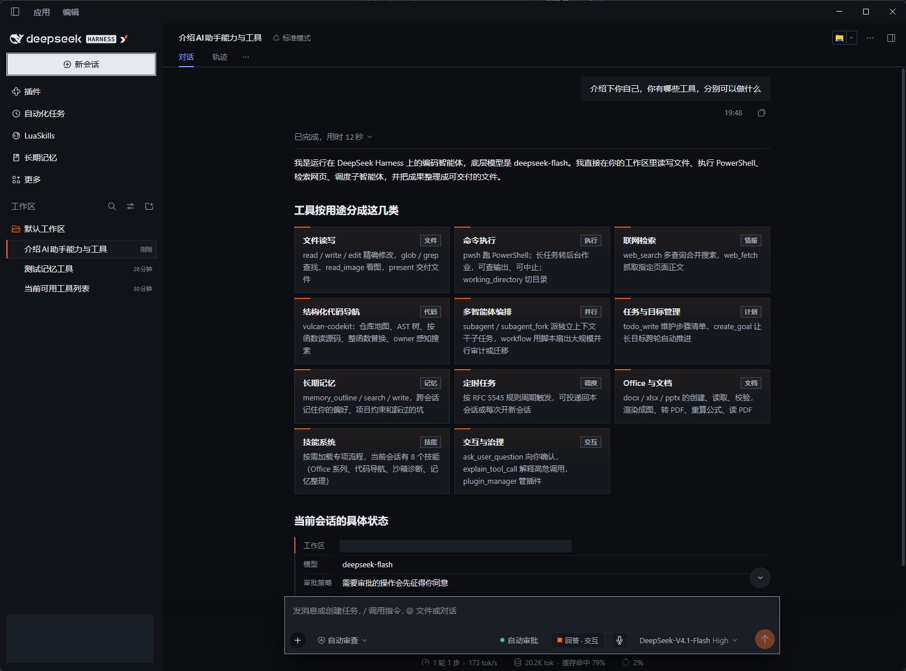
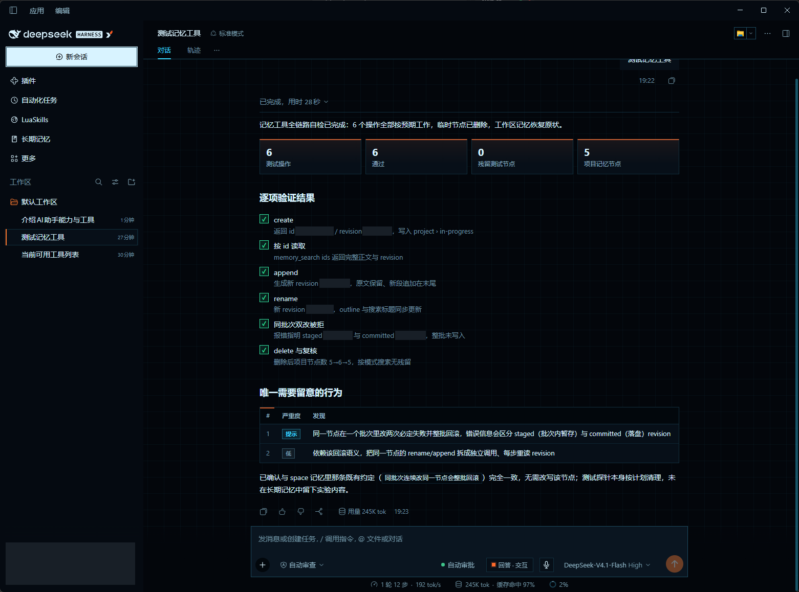

<div align="center">

<picture>
  <source media="(prefers-color-scheme: dark)" srcset="docs/assets/openvulcan-logo-dark.svg">
  
</picture>

# dsh-vulcancode

**把 VulcanCode 的体验带进 DeepSeek Harness（dsh）**

[](LICENSE)
[](https://www.npmjs.com/package/@openvulcan/dsh-vulcancode)

**简体中文** | [English](README.en.md)

[特色功能](#特色功能) · [界面截图](#界面截图) · [架构与包结构](#架构与包结构) · [快速开始](#快速开始) · [开发](#开发)

</div>

---

## 关于项目

dsh-vulcancode 是 DeepSeek Harness（dsh）的社区插件套件。安装一个包，即可在 dsh 中使用 VulcanCode 的界面风格、交互式回答、自动审批、LuaSkills 和长期记忆，并为 pi-ai 模型配置思考级别。

本项目与 DeepSeek 无关联，dsh 是 DeepSeek 的产品。

## 特色功能

- **桌面工作台**采用 VulcanCode 配色、可独立开关的直角外观，以及加宽后能充分利用内容区的设置页面。
- **结果可交互**，模型可在对话中用图表、流程图和决策卡片呈现结果。卡片里的选择可以带回输入框继续讨论。
- **工具调用可审查**，Vulcan Decision 在执行前使用云端或本机模型判定，并支持配置复核和人工确认。
- **技能与经验可复用**，LuaSkills 把技能发布为 AI 可调用的工具，Markdown 长期记忆保留用户、空间和项目经验。
- **模型可单独配置思考级别**，pi-ai 模型的可选级别和接口传输值可按供应商、按模型设置。
- **语音输入**使用 OpenVulcan 账号所属站点的免费转写服务，把口述内容插入对话草稿。

## 界面截图

### 暗色主题 · 工具分类卡片



### 指挥舱主题 · 记忆工具验证



## 架构与包结构

dsh 通过套件的 `cordis.patch.yml` 装载八个插件。自动审批和语音输入通过 `openvulcanAccount` 获取云端服务所需的凭据。账号插件和判定引擎复用同一账号库。发布包随附工作区依赖，用户只需安装套件。

### 套件入口

#### `@openvulcan/dsh-vulcancode`

套件通过 `dsh.bundle.patch` 声明插件组。dsh 加载各子插件的 `apply(ctx)` 入口，账号插件则导出 Cordis 服务类。安装后可在插件管理页查看套件及其组件。源码在 [packages/dsh-vulcancode](packages/dsh-vulcancode)。

### dsh 插件

#### `@openvulcan/dsh-vulcan-account`

在「设置 › OpenVulcan 账号」选择国际站或中国站，浏览器授权后即可在 dsh 内查看账号状态或退出登录。插件将凭据保存到 dsh 的凭据存储，并通过 `openvulcanAccount` 向云端判定等集成提供账号服务。源码在 [packages/dsh-vulcan-account](packages/dsh-vulcan-account)。

#### `@openvulcan/dsh-decision-guard`

在「设置 › 自动审批」选择与权限预设的接入方式，配置云端或本机判定、复核 LLM 和询问规则，并查看审批记录。判定模型给出放行、需确认或拦截三类结果。未放行的调用按配置进入复核、询问或拒绝。详见[自动审批的边界](#自动审批的边界)和[插件说明](packages/dsh-decision-guard/README.md)。

#### `@openvulcan/dsh-vulcan-answers`

在对话中渲染模型输出的 `ui-*` 代码围栏，例如对比表、图表、流程图、时序图和决策卡片。决策选项可以插入输入框或发送。对话默认使用交互模式，输入框里的「回答」可以按会话切换为标准 Markdown，从下次请求起生效。源码在 [packages/dsh-vulcan-answers](packages/dsh-vulcan-answers)。

#### `@openvulcan/dsh-vulcan-luaskills`

在「设置 › LuaSkills」按需安装约 190 MB 的运行库和默认代码导航技能 CodeKit。安装后引擎和工具自动接入，可以调整 VM 池、缓存、受管 Python / Node 和网络设置。侧栏「LuaSkills」可启用、停用、更新或卸载技能，也可从 LuaSkills Hub 搜索和安装新技能。源码在 [packages/dsh-vulcan-luaskills](packages/dsh-vulcan-luaskills)。

#### `@openvulcan/dsh-vulcan-memory`

以 Markdown 保存用户画像、空间记忆和项目记忆。向模型提供 `memory_outline`、`memory_search`、`memory_write` 与 `memory-curator` 技能，并在会话开始时按预算注入快照。侧栏「长期记忆」支持编辑、调整注入预算和导入导出。当前可用的是 Markdown 模式。源码在 [packages/dsh-vulcan-memory](packages/dsh-vulcan-memory)。

#### `@openvulcan/dsh-vulcan-reasoning`

在「设置 › 模型」展开已配置的 pi-ai 提供商卡片中的「自定义思考级别」。按模型选择跟随目录、关闭思考，或自定义对话中可选的级别及接口传输值。保存后在对话模型选择器中选用，传输值以对应模型接口支持的参数为准。源码在 [packages/dsh-vulcan-reasoning](packages/dsh-vulcan-reasoning)。

#### `@openvulcan/dsh-vulcan-style`

在「设置 › 通用设置」的「Vulcan 界面风格」选择跟随系统、亮色、暗色、指挥舱或 dsh 自带主题。直角开关可与任意主题搭配，覆盖 Windows 桌面内容区等界面边角。设置布局为模型目录、内置插件和 LuaSkills 等页面留出更多可用宽度。源码在 [packages/dsh-vulcan-style](packages/dsh-vulcan-style)。

#### `@openvulcan/dsh-vulcan-voice-input`

登录 OpenVulcan 后，将鼠标移到对话输入框的麦克风按钮，可选择所属站点发布的免费转写模型、优先语言、麦克风和录音快捷键。可在「设置 › OpenVulcan 语音输入」测试麦克风和查看服务状态。录音快捷键支持单独绑定右 Ctrl 等左右修饰键。按住麦克风按钮或在输入框内按住所设快捷键说话，松开后转写内容会回填当前草稿。连续录满 120 秒会自动停止并转写。源码在 [packages/dsh-vulcan-voice-input](packages/dsh-vulcan-voice-input)。

### 共享库与命令行

#### `@openvulcan/vulcan-decision`

为宿主提供 `allow`、`review` 和 `block` 判定，支持 OpenVulcan 云端端点和按需安装的本机运行包。随附的 `vulcan-decision` CLI 可用于探测云端、检查硬件、管理本机运行包和模型，以及对单次工具调用执行判定。详见[判定引擎与命令行说明](packages/vulcan-decision/README.md)。

#### `@openvulcan/openvulcan-account`

封装设备授权、凭据刷新、账号资料查询和设备注销，并定义 `CredentialStore` 存储接口。dsh 插件接入宿主凭据存储，独立 CLI 可使用库内的文件存储实现。源码在 [packages/openvulcan-account](packages/openvulcan-account)。

## 快速开始

套件声明兼容 dsh `>=0.2.1-rc.2 <0.3.0`。

### 桌面版

在 dsh 侧栏打开「插件」，点击「添加插件」，在安装框中粘贴以下 npm 包名并安装。

```text
@openvulcan/dsh-vulcancode
```

### 网页版

```sh
dsh plugin --profile web add @openvulcan/dsh-vulcancode
```

### 使用

1. 安装后重启 dsh。使用云端判定时，在「设置 › OpenVulcan 账号」完成浏览器授权。选用本机判定可以跳过账号登录。
2. 打开「设置 › 自动审批」配置判定方式。在权限选择器中选「自动审查」可对当前会话启用，该预设使用完全权限。改用「独立开关」会为所有会话叠加判定，并保留已有权限预设的文件沙箱。
3. 需要技能工具时，在「设置 › LuaSkills」安装运行库。进度显示在页面上，完成后技能工具自动接入。
4. 界面风格、交互式回答和 Markdown 长期记忆默认启用。思考级别可以在配置好 pi-ai 提供商后按模型调整。

> **我们承诺云端命令判定模型永久免费提供。**（2026 年 10 月 27 日）

## 自动审批的边界

- 自动审批可以降低 AI 误执行命令的风险。AI 刻意绕过时，仍可能先写脚本再运行它。
- 任何错误都不会被当作放行。无人值守时，需要复核的调用只有在复核明确放行后才会执行。
- 请同时使用沙箱、Git 与备份。

## 开发

```sh
pnpm install
pnpm run build
pnpm run test
pnpm run pack:dsh   # 生成 dist/openvulcan-dsh-vulcancode-<版本>.tgz
```

在网页版配置中安装本地包时，执行 `dsh plugin --profile web add ./dist/openvulcan-dsh-vulcancode-<版本>.tgz`。

## 致谢

感谢 [LINUX DO](https://linux.do/) 社区的支持与交流。

## 许可

[MIT](LICENSE)
