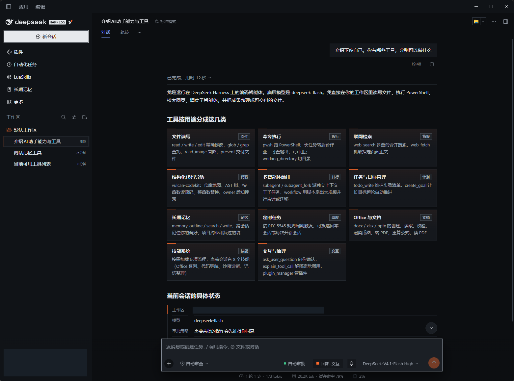
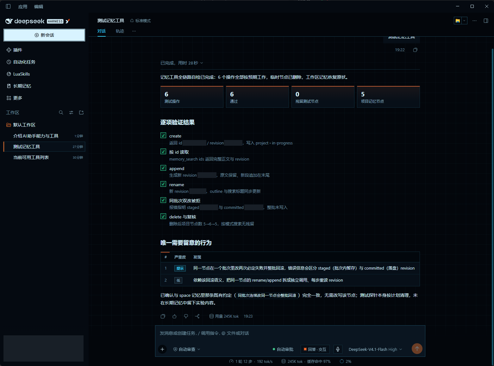

<div align="center">

<picture>
  <source media="(prefers-color-scheme: dark)" srcset="docs/assets/openvulcan-logo-dark.svg">
  
</picture>

# dsh-vulcancode

**把 VulcanCode 的体验带进 DeepSeek Harness（dsh）**

[](LICENSE)
[](https://www.npmjs.com/package/@openvulcan/dsh-vulcancode)

**简体中文** | [English](README.en.md)

[特色功能](#特色功能) · [界面截图](#界面截图) · [架构与包结构](#架构与包结构) · [快速开始](#快速开始) · [开发](#开发)

</div>

---

## 关于项目

dsh-vulcancode 是 DeepSeek Harness（dsh）的社区插件套件。安装一个包，即可在 dsh 中使用 VulcanCode 的界面风格、交互式回答、自动审批、LuaSkills 和长期记忆，并为 pi-ai 模型配置思考级别。

本项目与 DeepSeek 无关联，dsh 是 DeepSeek 的产品。

## 特色功能

- **桌面工作台**采用 VulcanCode 配色、可独立开关的直角外观，以及加宽后能充分利用内容区的设置页面。
- **结果可交互**，模型可在对话中用图表、流程图和决策卡片呈现结果。卡片里的选择可以带回输入框继续讨论。
- **工具调用可审查**，Vulcan Decision 在执行前使用云端或本机模型判定，并支持配置复核和人工确认。
- **技能与经验可复用**，LuaSkills 把技能发布为 AI 可调用的工具，Markdown 长期记忆保留用户、空间和项目经验。
- **模型可单独配置思考级别**，pi-ai 模型的可选级别和接口传输值可按供应商、按模型设置。
- **语音输入**使用 OpenVulcan 账号所属站点的免费转写服务，把口述内容插入对话草稿。

## 0.4.5 更新

- **LuaSkills** 升级到 0.9.0。Hub 打开即显示技能列表，支持分页和搜索。「环境」页可查看受管 Node.js、Python、包管理器的版本和路径。安装或加载运行库时按需补装缺失项，并复用已就绪的运行时。
- **平台兼容**。Windows 支持中文用户目录和安装路径，技能启动的受管进程默认隐藏控制台窗口。macOS 和 Linux 原生运行包修复了动态库加载与 FFI 符号解析。
- **长期记忆**新增独立的 VMM 向量模式，支持对话前召回、回合后提炼记忆和画像、36 个地区的 PII 规则及可调噪声过滤。Markdown 仍是默认模式。切换到 VMM 后，可在「模型与服务」下载 VLDB 并授权使用 OpenVulcan 免费模型。

## 界面截图

### 暗色主题 · 工具分类卡片



### 指挥舱主题 · 记忆工具验证



## 架构与包结构

dsh 通过套件的 `cordis.patch.yml` 装载八个插件。自动审批和语音输入通过 `openvulcanAccount` 获取云端服务所需的凭据。账号插件和判定引擎复用同一账号库。发布包随附工作区依赖，用户只需安装套件。

### 套件入口

#### `@openvulcan/dsh-vulcancode`

套件通过 `dsh.bundle.patch` 声明插件组。dsh 加载各子插件的 `apply(ctx)` 入口，账号插件则导出 Cordis 服务类。安装后可在插件管理页查看套件及其组件。源码在 [packages/dsh-vulcancode](packages/dsh-vulcancode)。

### dsh 插件

#### `@openvulcan/dsh-vulcan-account`

在「设置 › OpenVulcan 账号」选择国际站或中国站，浏览器授权后即可在 dsh 内查看账号状态或退出登录。插件将凭据保存到 dsh 的凭据存储，并通过 `openvulcanAccount` 向云端判定等集成提供账号服务。源码在 [packages/dsh-vulcan-account](packages/dsh-vulcan-account)。

#### `@openvulcan/dsh-decision-guard`

在「设置 › 自动审批」选择与权限预设的接入方式，配置云端或本机判定、复核 LLM 和询问规则，并查看审批记录。判定模型给出放行、需确认或拦截三类结果。未放行的调用按配置进入复核、询问或拒绝。详见[自动审批的边界](#自动审批的边界)和[插件说明](packages/dsh-decision-guard/README.md)。

#### `@openvulcan/dsh-vulcan-answers`

在对话中渲染模型输出的 `ui-*` 代码围栏，例如对比表、图表、流程图、时序图和决策卡片。决策选项可以插入输入框或发送。对话默认使用交互模式，输入框里的「回答」可以按会话切换为标准 Markdown，从下次请求起生效。源码在 [packages/dsh-vulcan-answers](packages/dsh-vulcan-answers)。

#### `@openvulcan/dsh-vulcan-luaskills`

在「设置 › LuaSkills」按需安装 LuaSkills 0.9.0 运行库和默认代码导航技能 CodeKit。已安装 0.7.2 或旧版运行包时，可在同一页面升级并保留技能、配置和启停状态。升级失败或取消后会恢复旧版。Windows 首次启动技能引擎时会下载专用 Node Worker，以支持中文路径。macOS 运行包需要 macOS 15.5 或更新版本。Linux 运行包支持 x64 和 ARM64，需要 glibc 2.35 或更新版本。

侧栏「LuaSkills」可管理本地技能，在「Hub」按页浏览和搜索技能，也可在「环境」查看受管 Node.js、Python 和配套包管理器的版本、可执行文件路径及安装状态。启用网络下载时，安装 LuaSkills 或加载已有运行库会补装缺失项，已就绪的解释器会直接复用。也可从「环境」或「设置 › LuaSkills」分别补装。源码在 [packages/dsh-vulcan-luaskills](packages/dsh-vulcan-luaskills)。

#### `@openvulcan/dsh-vulcan-memory`

默认使用 Markdown 保存用户画像、空间记忆和项目记忆。向模型提供 `memory_outline`、`memory_search`、`memory_write` 与 `memory-curator` 技能，并在会话开始时按预算注入快照。侧栏「长期记忆」支持编辑、调整注入预算和导入导出。源码在 [packages/dsh-vulcan-memory](packages/dsh-vulcan-memory)。

在「长期记忆 → 记忆模式」选择 **VMM 向量记忆** 并保存，即可进入「模型与服务」。这里显示 OpenVulcan 账号所属站点的默认免费方案及各阶段模型，并提供 VLDB 下载、地区 PII 脱敏预览和噪声过滤设置。启用后，对话前执行 VMM 召回，正常完成的回合会在噪声筛选后提炼并审核记忆与画像。VLDB 通过 FFI 在本机执行向量检索，Jieba 和 FTS5 补充中文词法匹配。

PII 使用通用规则和选定地区的规则，内置 36 个地区，支持编辑、恢复和本机样例测试。VMM 手工保存、模型上下文和云端业务数据会应用脱敏。噪声过滤可选通用或通用加简体中文规则，支持本机正则测试与语义阈值。语义判定使用获授权的 OpenVulcan 免费嵌入，嵌入故障时使用本地正则结果。

VMM 与 Markdown 互斥，分别保存数据。切换后，下一次请求使用当前模式的工具和记忆上下文。VMM 模式提供 `vmm_memory_search` 和 `vmm_memory_write`。升级保留已有结构化记录，启用自动记忆后会跨项目分批补建向量。原有授权适用于手动功能，自动功能需要重新确认。VLDB 从 GitHub Release 按平台下载、校验并缓存，覆盖 Windows x64、macOS x64/arm64 和 Linux glibc x64/arm64。 [VLDB 发行包](https://github.com/OpenVulcan/vldb-lancedb/releases/tag/v0.1.5)

#### `@openvulcan/dsh-vulcan-reasoning`

在「设置 › 模型」展开已配置的 pi-ai 提供商卡片中的「自定义思考级别」。按模型选择跟随目录、关闭思考，或自定义对话中可选的级别及接口传输值。保存后在对话模型选择器中选用，传输值以对应模型接口支持的参数为准。源码在 [packages/dsh-vulcan-reasoning](packages/dsh-vulcan-reasoning)。

#### `@openvulcan/dsh-vulcan-style`

在「设置 › 通用设置」的「Vulcan 界面风格」选择跟随系统、亮色、暗色、指挥舱或 dsh 自带主题。直角开关可与任意主题搭配，覆盖 Windows 桌面内容区等界面边角。设置布局为模型目录、内置插件和 LuaSkills 等页面留出更多可用宽度。源码在 [packages/dsh-vulcan-style](packages/dsh-vulcan-style)。

#### `@openvulcan/dsh-vulcan-voice-input`

登录 OpenVulcan 后，将鼠标移到对话输入框的麦克风按钮，可选择所属站点发布的免费转写模型、优先语言、麦克风和录音快捷键。可在「设置 › OpenVulcan 语音输入」测试麦克风和查看服务状态。录音快捷键支持单独绑定右 Ctrl 等左右修饰键。按住麦克风按钮或在输入框内按住所设快捷键说话，松开后转写内容会回填当前草稿。连续录满 120 秒会自动停止并转写。源码在 [packages/dsh-vulcan-voice-input](packages/dsh-vulcan-voice-input)。

### 共享库与命令行

#### `@openvulcan/vulcan-decision`

为宿主提供 `allow`、`review` 和 `block` 判定，支持 OpenVulcan 云端端点和按需安装的本机运行包。随附的 `vulcan-decision` CLI 可用于探测云端、检查硬件、管理本机运行包和模型，以及对单次工具调用执行判定。详见[判定引擎与命令行说明](packages/vulcan-decision/README.md)。

#### `@openvulcan/openvulcan-account`

封装设备授权、凭据刷新、账号资料查询和设备注销，并定义 `CredentialStore` 存储接口。dsh 插件接入宿主凭据存储，独立 CLI 可使用库内的文件存储实现。源码在 [packages/openvulcan-account](packages/openvulcan-account)。

## 快速开始

套件声明兼容 dsh `>=0.2.1-rc.2 <0.3.0`。

### 桌面版

在 dsh 侧栏打开「插件」，点击「添加插件」，在安装框中粘贴以下 npm 包名并安装。

```text
@openvulcan/dsh-vulcancode
```

### 网页版

```sh
dsh plugin --profile web add @openvulcan/dsh-vulcancode
```

如需指定版本，在桌面安装框或命令中使用 `@openvulcan/dsh-vulcancode@0.4.5`。

### 使用

1. 安装后重启 dsh。使用云端判定时，在「设置 › OpenVulcan 账号」完成浏览器授权。选用本机判定可以跳过账号登录。
2. 打开「设置 › 自动审批」配置判定方式。在权限选择器中选「自动审查」可对当前会话启用，该预设使用完全权限。改用「独立开关」会为所有会话叠加判定，并保留已有权限预设的文件沙箱。
3. 需要技能工具时，在「设置 › LuaSkills」安装运行库。进度显示在页面上，完成后技能工具自动接入。
4. 界面风格、交互式回答和 Markdown 长期记忆默认启用。思考级别可以在配置好 pi-ai 提供商后按模型调整。

> **我们承诺云端命令判定模型永久免费提供。**（2026 年 10 月 27 日）

## 自动审批的边界

- 自动审批可以降低 AI 误执行命令的风险。AI 刻意绕过时，仍可能先写脚本再运行它。
- 任何错误都不会被当作放行。无人值守时，需要复核的调用只有在复核明确放行后才会执行。
- 请同时使用沙箱、Git 与备份。

## 开发

```sh
pnpm install
pnpm run build
pnpm run test
```

打包前，从 [Lua 运行包 v0.1.9](https://github.com/LuaSkills/luaskills-packages/releases/tag/v0.1.9) 和 [LuaSkills FFI v0.9.0](https://github.com/LuaSkills/luaskills/releases/tag/v0.9.0) 获取四个平台的原始归档。在 Linux 构建环境使用 GNU tar、readelf、Zig 0.16、LLVM 21 与 rcodesign 0.29。将 LLVM 工具置于 PATH，并将 `DSH_MACOS_SDK` 指向 macOS 15.5 SDK。以 Linux ARM64 为例，运行以下命令。其余三个目标使用 `linux-x64`、`macos-arm64` 和 `macos-x64` 替换平台名及对应文件名。

```sh
node scripts/prepare-luaskills-unix.mjs linux-arm64 \
  lua-runtime-packages-linux-arm64.tar.gz luaskills-ffi-sdk-linux-arm64.tar.gz \
  packages/dsh-vulcan-luaskills/assets/native/linux-arm64.tar.gz
pnpm run pack:dsh
```

在网页版配置中安装本地包时，执行 `dsh plugin --profile web add ./dist/openvulcan-dsh-vulcancode-<版本>.tgz`。

## 致谢

感谢 [LINUX DO](https://linux.do/) 社区的支持与交流。

## 许可

[MIT](LICENSE)
